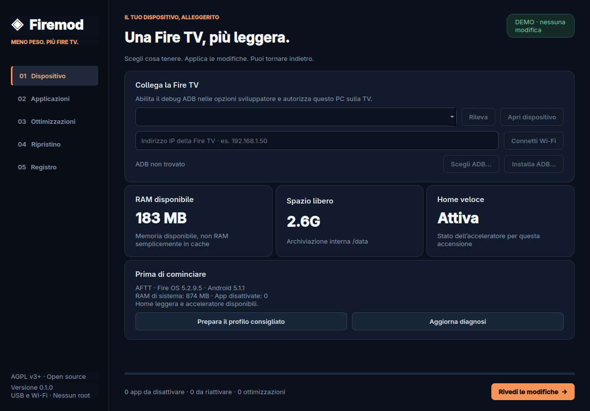

# Firemod

**A lighter Fire TV, with a way back.**

Firemod is an open-source Linux/Windows desktop application. Connect an Android-based Amazon Fire TV over ADB, choose which optional apps to keep active, apply responsiveness and privacy settings, and restore the original values from a local per-device journal.



[Downloads](https://github.com/Macer94/Firemod/releases) · [Full Italian guide](README.md) · [Compatibility](docs/COMPATIBILITY.md) · [Build instructions](docs/BUILDING.md)

## Features

- Deactivate/reactivate optional apps while keeping their data and logins; no bulk uninstaller.
- Reduce or remove animations, limit supported usage metrics/ad tracking, optionally disable the photographic screensaver.
- On **Fire OS 5 / API 22**, install offline Luncher plus Firemod Home.
- Start a fixed-action Home accelerator for the current device boot.
- Write the undo record before changing anything and verify the actual state afterward.

Amazon Home and essential components are kept. Firmware refusals are reported, not counted as success. This does not root/flash/reset devices, remove advertisements inside streaming apps, or free the APK storage of hidden apps.

## Download and connect

Use the Linux `.tar.gz` or Windows `.zip` package from Releases. Extract the entire folder; keep the executable and `_internal` directory together. Run `Firemod/Firemod` on Linux or `Firemod/Firemod.exe` on Windows. Python is not required. Packages are unsigned; the UI is currently Italian. Linux CI builds use Ubuntu 22.04; local builds inherit their build-machine compatibility limits.

1. Enable ADB debugging in Fire TV Developer Options and authorize your PC on the TV. If Developer Options is hidden, press the device name seven times in About.
2. Connect by a supported USB data cable, or enter the Fire TV IP on the same network (normally port 5555).
3. Firemod finds `adb` in PATH/Android SDK, lets you choose it, or downloads official Google Platform-Tools after displaying their terms.
4. Click **Rileva**, select the device, then **Apri dispositivo**.
5. Choose apps and options; **Prepara il profilo consigliato** only prepares a selection. **Rivedi le modifiche** shows the concrete plan before applying it.

References: [Amazon ADB guide](https://developer.amazon.com/docs/fire-tv/connecting-adb-to-device.html), [official Platform-Tools](https://developer.android.com/tools/releases/platform-tools).

## Home acceleration

The original single-device AFTT / Fire OS 5.2.9.5 prototype measured approximately **6–7 seconds to 1.3–1.6 seconds** for Home transitions. Those PC-triggered measurements include ADB input overhead and are not frame-accurate remote-control or cold-boot benchmarks. See [benchmark data](docs/benchmark.json).

The accelerator starts as an ADB shell process, accepts a numeric request in the companion's external app directory, and performs one fixed action: bring Luncher forward through the system activity service. It has no arbitrary command parser or network listener. The companion has no Internet permission.

**The accelerator survives closing Firemod and disconnecting the PC, but not a full reboot or power loss.** Reconnect and select only the accelerator option to re-enable it. The normal Home companion starts automatically and remains the fallback. Sleep is not a reboot; firmware and remote behavior may affect wake-up. This does not make Android boot in 0.1 seconds.

## Restore and privacy

Use **Ripristino** to restore a point for the selected device. Previous values and package states are restored; absent settings keys are removed. Only companions newly installed by that operation are uninstalled. Existing Luncher installations are kept; original companion APKs are backed up before upgrades. Split APK replacement is refused.

History lives in `${XDG_DATA_HOME:-~/.local/share}/Firemod` on Linux or `%LOCALAPPDATA%/Firemod` on Windows. Keep it for restoration. It contains device identifiers and original settings, stays outside the repository, and is never uploaded by Firemod. Do not attach it to public bug reports. Restoration is not a full disk-image backup.

## Source

Requires Python 3.12+:

```bash
python -m venv .venv
# Activate .venv for your operating system.
python -m pip install -r requirements-build.txt
python -m pip install --no-build-isolation --no-deps -e .
python -m firemod.app
```

Read-only preview: `python -m firemod.app --demo`.

Checks: `python -m pytest -q` and `ruff check src tests scripts`.

## License

Original Firemod code: **AGPL-3.0-or-later**, see [LICENSE](LICENSE). Third-party components keep their own licenses; see [THIRD_PARTY_NOTICES.md](THIRD_PARTY_NOTICES.md). Firemod is independent of Amazon and Google.
