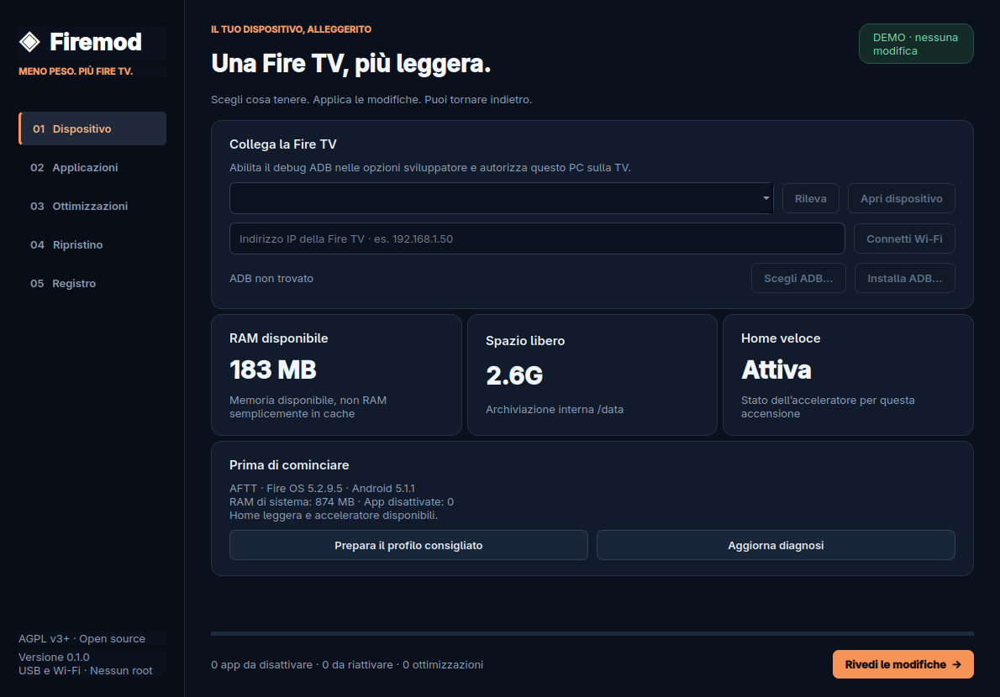

# Firemod

[](https://github.com/Macer94/Firemod/actions/workflows/build.yml)
[](https://github.com/Macer94/Firemod/releases/latest)
[](LICENSE)

**Una Fire TV più leggera, con la possibilità di tornare indietro.**

Un tool grafico open source per **Linux e Windows**: collega una Fire TV, scegli quali app tenere attive e applica ottimizzazioni alla reattività, alla home e alla privacy. Prima delle modifiche, Firemod salva un punto di ripristino sul PC.

[Download](https://github.com/Macer94/Firemod/releases/latest) · [Manuale utenti](docs/USER_GUIDE.it.md) · [Guida agenti](docs/AGENT_GUIDE.md) · [English](README.en.md)



## Da dove cominciare

| Vuoi… | Leggi / apri |
| --- | --- |
| Usare il programma senza compilare | [Release e download](https://github.com/Macer94/Firemod/releases/latest), poi [manuale passo passo](docs/USER_GUIDE.it.md) |
| Capire se il tuo modello è adatto | [Compatibilità e limiti](docs/COMPATIBILITY.md) |
| Far assistere un agente nell’uso del tool | [Guida operativa per agenti](docs/AGENT_GUIDE.md) |
| Modificare il progetto, anche con un agente | [CONTRIBUTING.md](CONTRIBUTING.md) e [AGENTS.md](AGENTS.md) |
| Compilare o preparare una release | [BUILDING.md](docs/BUILDING.md) |

Queste istruzioni descrivono **Firemod 0.1.0**. La documentazione su `main` può ricevere chiarimenti dopo la pubblicazione degli eseguibili; i sorgenti esatti della release restano nel [tag v0.1.0](https://github.com/Macer94/Firemod/tree/v0.1.0). Le istruzioni non richiedono di modificare manualmente pacchetti o permessi via ADB.

## Funzioni

- **Applicazioni:** disattiva o riattiva le app opzionali selezionate, conservando dati e accessi.
- **Animazioni:** riduci la durata o elimina le animazioni dell’interfaccia.
- **Privacy:** limita le statistiche d’uso e il tracciamento pubblicitario tramite le impostazioni supportate.
- **Screensaver:** disattiva lo screensaver fotografico, se non ti serve.
- **Home essenziale:** su **Fire OS 5 / API 22**, installa [Luncher](https://github.com/CVasilakis/luncher), offline e senza inserzioni nella home, con il companion Firemod Home.
- **Acceleratore Home:** riduce l’attesa del passaggio a Luncher, per l’accensione corrente del dispositivo.
- **Ripristino:** recupera impostazioni e stati delle app dai punti salvati per quel dispositivo.

Firemod conserva i componenti essenziali e la home Amazon, utile per impostazioni e ripristino. Se il firmware rifiuta un’operazione, il tool la segnala come **non applicata**. Non esegue root, modifiche hardware, aggiornamenti del firmware o reset di fabbrica.

La gestione app usa disattivazione e occultamento: **non cancella le app in massa e non libera lo spazio occupato dai loro APK**. Le pubblicità interne a YouTube, Prime Video e altre app rimangono gestite dalle rispettive app.

## Versioni compilate

Servono un PC **x86_64**, un desktop grafico, una Fire TV con **Fire OS basato su Android** e il consenso al debug sullo schermo della TV. Python serve soltanto a chi usa i sorgenti. Le build native della prima release hanno superato 33 test su Ubuntu 22.04 e Windows Server 2022, oltre alla prova di apertura degli eseguibili: questo verifica il software desktop, non tutti i modelli Fire TV. Non sono disponibili pacchetti ARM, macOS o Vega OS.

I pacchetti della sezione **Releases** sono:

- Linux x86_64: `Firemod-0.1.0-linux-x86_64.tar.gz`
- Windows x86_64: `Firemod-0.1.0-windows-x86_64.zip`

Non serve installare Python. Estrai l’intera cartella: l’eseguibile e la directory `_internal` devono restare insieme.

Su Linux:

```bash
tar -xzf Firemod-0.1.0-linux-x86_64.tar.gz
./Firemod/Firemod
```

Su Windows, estrai lo ZIP e apri `Firemod/Firemod.exe`. Gli eseguibili non sono firmati digitalmente. Le build CI Linux usano Ubuntu 22.04; una build locale può richiedere librerie della distribuzione su cui è stata compilata. L’interfaccia è attualmente in italiano.

Scarica anche `SHA256SUMS` dalla stessa release e confronta l’hash del tuo archivio. Nel [manuale](docs/USER_GUIDE.it.md#2-scaricare-verificare-e-avviare) trovi i comandi Linux e PowerShell, insieme alla gestione dei file estratti. Un checksum verifica la corrispondenza con il file pubblicato: non è una firma digitale.

La release offre inoltre `Firemod-0.1.0-documentation.zip` e il relativo `.sha256`: contiene il README ampliato e le guide per utenti/agenti. Gli eseguibili originali 0.1.0 conservano il README iniziale; questo archivio aggiorna soltanto la documentazione. Le build successive da `main` includono le guide accanto all’eseguibile.

## Prima connessione

1. Sulla Fire TV abilita **Debug ADB** nelle **Opzioni sviluppatore**. Se il menu non compare, apri **Informazioni** e premi sette volte sul nome del dispositivo. Per installare Luncher e il companion, controlla anche le opzioni di installazione da origini sconosciute previste dal firmware.
2. Usa un **cavo USB dati**, se il modello lo supporta, oppure collega PC e Fire TV alla stessa rete e annota l’IP della chiavetta. La connessione Wi-Fi ADB usa normalmente la porta `5555`.
3. Accetta sulla TV la richiesta di autorizzazione del PC. Il tool non può aggirarla o abilitare il debug quando è disattivato.
4. Avvia Firemod. Se ADB è nel PATH o nell’Android SDK viene rilevato automaticamente. In alternativa, usa **Scegli ADB…** oppure **Installa ADB…**: quest’ultimo mostra il riferimento ai termini SDK di Google e scarica i Platform-Tools ufficiali dopo la conferma.
5. Premi **Rileva**, seleziona il dispositivo giusto e scegli **Apri dispositivo**. Per il Wi-Fi, inserisci prima l’IP e premi **Connetti Wi-Fi**.

Riferimenti: [guida ADB Amazon](https://developer.amazon.com/docs/fire-tv/connecting-adb-to-device.html), [Platform-Tools Android](https://developer.android.com/tools/releases/platform-tools).

## Applica le migliorie

1. In **Applicazioni**, seleziona le app da disattivare oppure da riattivare. Le altre restano come sono.
2. In **Ottimizzazioni**, scegli gli interventi. **Prepara il profilo consigliato** seleziona alcune opzioni, senza applicarle automaticamente e senza scegliere app da rimuovere.
3. Premi **Rivedi le modifiche** e controlla il piano prima di applicarlo.
4. Leggi il riepilogo: distingue operazioni completate, rifiuti del firmware ed errori. Il registro contiene i dettagli.

Ogni valore precedente viene salvato **prima** della modifica. Il tool verifica poi lo stato restituito dal dispositivo: un messaggio apparentemente positivo non basta a dichiarare riuscita l’operazione.

**La casella accanto a un’app è una selezione di lavoro:** selezionare un’app attiva prepara la disattivazione; selezionare un’app inattiva prepara la riattivazione. Non è una lista permanente delle app da tenere. Il riepilogo distingue entrambe le azioni. Il filtro di ricerca può nascondere righe già selezionate: controlla sempre l’intero piano.

Il profilo consigliato imposta animazioni a `0`, privacy e, su API 22, Home e acceleratore. **Conserva le eventuali selezioni delle app e dello screensaver già fatte**. Nessuna modifica viene applicata prima della conferma del piano. Le opzioni possono restare selezionate dopo un’operazione: per riattivare soltanto l’acceleratore, deseleziona le altre opzioni.

| Risultato nel registro | Significato |
| --- | --- |
| `[OK]` | Operazione completata; per impostazioni e stati app è stato verificato il valore restituito |
| `[INVARIATO]` | Operazione non necessaria, non supportata o rifiutata; leggi il motivo |
| `[ERRORE]` | Operazione non completata; altre operazioni dello stesso piano possono essere riuscite |

Un piano non è una transazione unica e non annulla automaticamente tutte le operazioni se una fallisce. Controlla il registro e usa il punto di ripristino se vuoi annullare quanto già applicato.

## Home veloce: risultati e limiti

Nel prototipo originale, su una Fire TV Stick AFTT con Fire OS 5.2.9.5, il ritorno alla home è passato da circa **6–7 secondi a 1,3–1,6 secondi**. Sono misure da PC su un singolo dispositivo, comprensive del tempo del comando ADB; non sono una garanzia per altri modelli. [Dati del confronto](docs/benchmark.json).

L’acceleratore viene avviato con i permessi della shell ADB. Il companion gli invia una richiesta attraverso la propria cartella esterna; l’acceleratore chiede al servizio delle attività di riportare Luncher in primo piano. Esegue soltanto questa azione fissa: **non accetta comandi shell arbitrari e non apre porte di rete**. Il companion non richiede Internet.

**Puoi chiudere Firemod e scollegare il PC: l’acceleratore continua a funzionare finché la Fire TV rimane accesa. Dopo un riavvio completo o una perdita di alimentazione va riattivato dal PC.** Ricollega il dispositivo e seleziona soltanto l’opzione dell’acceleratore. Nel frattempo resta disponibile il metodo standard, che parte automaticamente.

Lo standby non equivale al riavvio; le schermate di risveglio dipendono anche dal firmware e dal telecomando. L’intervento accelera il passaggio alla home; **non porta l’avvio completo di Android a 0,1 secondi**.

## Ripristino e dati locali

Apri **Ripristino**, seleziona un punto del dispositivo connesso e conferma il ripristino. Firemod recupera i valori precedenti; se una chiave non esisteva, la elimina. Riporta le app allo stato registrato e rimuove soltanto i companion installati da quell’operazione.

Un Luncher già presente viene conservato. Prima di aggiornare un companion esistente viene salvato il suo APK; pacchetti con APK suddivisi in più file non vengono sostituiti. Il ripristino non è un’immagine completa del dispositivo e non recupera dati modificati al di fuori di queste operazioni.

I punti di ripristino restano in:

- Linux: `${XDG_DATA_HOME:-~/.local/share}/Firemod`
- Windows: `%LOCALAPPDATA%/Firemod`

Conserva questa cartella per ripristinare in futuro. Contiene identificatori del dispositivo e impostazioni originali: non pubblicarla nei bug report. È separata dal repository e Firemod non la invia a nessun servizio.

In 0.1.0 la cronologia è associata al **seriale ADB**, che via rete è normalmente `IP:porta`. Cambiare IP o passare da USB a Wi-Fi può far apparire una cronologia diversa anche sulla stessa Fire TV. Mantieni lo stesso identificatore per ritrovare i punti; la migrazione automatica non è implementata. Il [manuale](docs/USER_GUIDE.it.md#7-ripristino-e-conservazione-dei-dati) spiega ripristini successivi, copia dei dati e limiti.

## Compatibilità

Il lavoro originale è stato verificato su **Fire TV Stick 2ª generazione, AFTT/tank, Fire OS 5.2.9.5**. La prima versione limita integrazione Home e acceleratore a **API 22**. Su versioni successive espone gestione app e impostazioni; disponibilità ed effetti dipendono dal firmware e non sono ancora verificati su quegli hardware.

I dispositivi **Vega OS**, che non eseguono app Android, non sono supportati. Vedi la [matrice di compatibilità](docs/COMPATIBILITY.md).

## Dal sorgente

Per riprodurre l’ambiente CI usa **Python 3.12** e Git. Il progetto dichiara Python 3.12 o successivo; versioni successive non equivalgono a una verifica CI. Non occorre installare Android Studio per il solo programma desktop.

Linux, dalla cartella in cui vuoi scaricare il progetto:

```bash
git clone https://github.com/Macer94/Firemod.git
cd Firemod
python3.12 -m venv .venv
.venv/bin/python -m pip install -r requirements-build.txt
.venv/bin/python -m pip install --no-build-isolation --no-deps -e .
.venv/bin/python -m firemod.app
```

Windows PowerShell:

```powershell
git clone https://github.com/Macer94/Firemod.git
Set-Location Firemod
py -3.12 -m venv .venv
.\.venv\Scripts\python.exe -m pip install -r requirements-build.txt
.\.venv\Scripts\python.exe -m pip install --no-build-isolation --no-deps -e .
.\.venv\Scripts\python.exe -m firemod.app
```

I comandi usano direttamente Python dell’ambiente, senza richiedere l’attivazione di script PowerShell. Nell’ambiente preparato, le opzioni sono `python -m firemod.app --demo`, `--screenshot PERCORSO` e `--diagnose SERIALE_ADB`; [qui](docs/AGENT_GUIDE.md#3-interfacce-reali-disponibili) trovi sintassi, output e limiti. Non esiste una CLI per applicare o importare un piano JSON in 0.1.0.

Verifiche nell’ambiente: `python -m pytest -q` e `python -m ruff check src tests scripts`.

Per compilare desktop e componenti Android, consulta [BUILDING.md](docs/BUILDING.md).

## Problemi comuni e assistenza

- **Nessun dispositivo / `unauthorized`:** abilita il debug, autorizza il PC sulla TV e ripeti **Rileva**. Per USB servono porta e cavo dati compatibili; per Wi-Fi usa l’IP reale della Fire TV.
- **App protetta o rifiuto del firmware:** il tool conserva i blocchi; non considera l’operazione riuscita. ADB non rende automaticamente modificabile un’app di sistema.
- **Home tornata lenta dopo un riavvio:** ricollega il PC e attiva soltanto l’acceleratore; controlla poi **Home veloce: Attiva**.
- **Cronologia vuota:** controlla account del PC, cartella dati e identificatore ADB usato per creare i punti.
- **Linux non apre la GUI / errore Qt:** consulta la sezione problemi del [manuale](docs/USER_GUIDE.it.md#9-risoluzione-dei-problemi).

Apri una [issue](https://github.com/Macer94/Firemod/issues) indicando versione Firemod, sistema del PC, modello e versione Fire OS, passaggi e messaggio d’errore depurato. Non allegare seriali, IP personali, credenziali, chiavi ADB, backup APK o l’intera cronologia. Il programma non ha un comando di caricamento automatico dei report.

## Licenza e riconoscimenti

Il codice originale di Firemod è **AGPL-3.0-or-later**: [LICENSE](LICENSE). I componenti di terze parti mantengono le rispettive licenze: Luncher, il companion derivato da Firehome, Qt/PySide6, Python e PyInstaller sono elencati in [THIRD_PARTY_NOTICES.md](THIRD_PARTY_NOTICES.md).

Firemod è indipendente e non è affiliato ad Amazon o Google.
